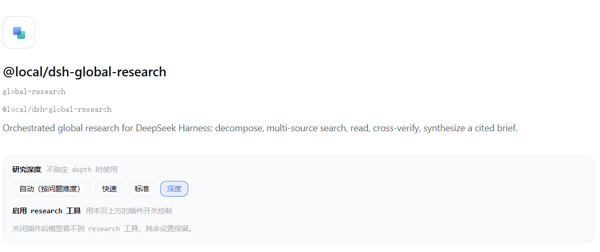

# @local/dsh-global-research

为 DeepSeek Harness 增加一个 `research` 工具：把一个**开放问题**当成研究任务来做，而不是把关键词丢给搜索框。

它做的事：拆题 → 生成多角度 query → 多引擎并行检索 → 去重排序 → 精读网页 → 抽证据卡 → 交叉验证 → 缺口回补 → 写成带 `[S1]` 行内引用的简报。

## 和 web_search / web_fetch 的区别

| | `web_search` | `research` |
|---|---|---|
| 输入 | 关键词 | 完整问题（含背景与要做的决定） |
| 输出 | 链接列表 | 结论、依据、方案对比、坑、置信度、未解决 |
| 过程 | 一次检索 | 拆题 + 多轮检索 + 精读 + 交叉验证 |
| 引用 | 无 | 每句关键论断带 `[S#]`，可回溯到原页 |
| 失败 | 报错 | 证据不足标 `low` + `gaps`，不编造；超预算返回 `partial` |

## 安装

```powershell
plugin_manager install_bundle target: D:\Total\dsh-global-research
```

安装后对当前 profile 的所有会话生效；新会话里模型会看到 `research` 工具。

改完代码需要重载（host 缓存模块）：

```text
plugin_manager set_plugin target: include:global-research enabled: false
plugin_manager set_plugin target: include:global-research enabled: true
```

## 用法

模型自己决定何时调用；也可以在对话里直接要求"用 research 调研……"。

```json
{
  "question": "2026 年给一个 Node.js 后端项目选包管理器：pnpm / yarn / bun 怎么选？",
  "depth": "auto",
  "focus": ["性能", "生态兼容", "迁移成本"],
  "outputLanguage": "zh"
}
```

- `question`：完整问题（含背景与要做的决定），不是关键词；上限 2000 字。
- `depth`：`auto`（默认，按问题里的对比/选型/约束词判断）/ `quick` / `standard` / `deep`。
- `focus`：评估维度，参与 query 生成与结果排序。
- `outputLanguage`：`zh` / `en` / `auto`。
- `context`（可选，≤2000 字）：追问上一轮结果时，把被指代的结论/证据原文附进来。research 看不到对话历史；带 context 的调用不走缓存。
- `researchId`（可选）：上一轮返回的会话 id（简报末尾 `> 研究会话：rs_…` 那行）。传回来即"续跑"：复用上一轮已读的页面与证据，只补新缺口，通常快 2–3 倍；30 分钟内有效，过期或不存在会静默回退成全新研究。

返回对象含 `brief`（Markdown）、`confidence`、`sources`、`gaps`、`partial`、`depthUsed`、`researchId`、`stats`；工具界面只展示简报。

简报末尾（「参考」之后）固定带一行运行统计，例如 `> 本次检索：6 个查询 · 9 个页面 · 14 条证据 · 73 秒（标准档）`——不用打开 `debugStats` 也能看到这次查了多少、抓了多少、用了多久；续跑时页面数只算新抓的，并标注 `· 复用 N 页`。同一结果重复渲染不会出现两行。Web 卡片会把这一行解析成标题下方的小字徽章。

## 预算

| depth | queries | pages | LLM 轮 | 补搜轮 | 墙钟 |
|---|---|---|---|---|---|
| quick | 2 | 3 | 6 | 0 | 90s |
| standard | 6 | 12 | 14 | 1 | 180s |
| deep | 16 | 30 | 28 | 1 | 300s |

超出预算/时间返回 `partial:true`，并在「未解决」写明剩余问题，不编造。

同一 agent 在进程内最多 5 次 `deep`，超出自动降为 `standard`（`maxDeepPerSession`）。

## 配置

`cordis.patch.yml` 里的 `config`：

| key | 默认 | 说明 |
|---|---|---|
| `depthDefault` | `auto` | 未传 `depth` 时的档位；插件设置页里可改，改动即时生效（volatile） |
| `maxDeepPerSession` | `5` | 每 agent 的 deep 次数上限 |
| `engines.ctxWeb` | `true` | 复用 Harness 的 `ctx.web.search` |
| `engines.ddgHtml` | `true` | DuckDuckGo HTML 端点，零 key（本机实测常被 challenge 页拦截） |
| `engines.tavily/brave/serper/exa` | `false` | 开启后读取 `config.keys.<name>` 或环境变量 |
| `keys.<name>` | `{}` | 付费引擎 key 的内联写法（可选，见下） |
| `pageFetcher` | `raw` | 正文抓取路径：`raw`=自带 HTTP+抽取（最忠实，默认）；`web`=只用宿主 `web.fetch`；`auto`=先 web，正文太薄再用 raw 重试 |
| `useJinaFallback` | `false` | JS 重站点用 `r.jina.ai` 兜底取正文 |
| `timeoutMs` | `120000` | 工具级超时下限；实际取 `max(配置, deep 的 300s) + 20s`，避免 deep 被工具超时先杀掉 |
| `verboseLog` | `false` | 打印引擎失败、重试等日志 |
| `debugStats` | `false` | 在简报末尾额外附「调试统计」一行（引擎、垂直源、官方直取、回补、域名），排查召回问题时用；查询数/页数/证据数/耗时已固定显示在「本次检索」行，不在这里重复 |
| `cache.enabled` | `true` | 同一问题（question/depth/focus/outputLanguage 全同）在 TTL 内复用上一次简报，不再花检索与模型额度；`partial` 结果不入缓存 |
| `cache.ttlMinutes` | `60` | 缓存有效期（1–1440 分钟） |
| `cache.maxEntries` | `16` | 进程内最多保留多少条结果（LRU 淘汰） |
| `domainTrust.trusted` | `[]` | 额外视为一手/可信来源的域名（可写 URL，自动取 host），参与排序与一手来源门槛 |
| `domainTrust.blocked` | `[]` | 直接排除的域名（内容农场、垃圾站），排序前过滤 |

配置文件由 `lib/config.js` 校验：布尔/数字支持字符串写法，越界值夹取，未知 `engines`/`verticals` 键、非法枚举与错误类型都记 warning 后回退默认值——写错配置不会让工具直接崩掉。

### 设置页（默认深度与启停）

插件列表里点开 `@local/dsh-global-research` 这一行：

- **默认深度**：`自动 / 快速 / 标准 / 深度` 四个圆角按钮，点选即保存。该字段声明为 volatile，宿主原地更新配置、不重启插件，下一次 `research` 调用就按新档位走。
- **输入框右侧的「深度」胶囊是只读提示**：显示当前默认档位；点击只是把设置路径复制到剪贴板，不能就地改档——宿主没有向插件的 client 半开放写配置的通道，真正改档请回到本页。
- **启用 / 停用**：用行右侧的插件总开关（等价于 `pluginManager.setPluginEnabled`）；关闭后重新加载插件，工具不出现在模型工具表里，其余配置保留。
- 改动配置页后不需要重启；但**页面本身**（含客户端卡片）只在桌面应用启动时加载，`Ctrl+R` 不会重载，需要用菜单「应用 → 重新加载」或关掉窗口重开。

### 结果缓存

同一 `question` + `depth` + `focus` + `outputLanguage` 在 `cache.ttlMinutes` 内再次调用时，直接返回上次的简报（`stats.cached=true`、`cachedAgeMinutes=N`、`elapsedMs=0`），不再发起检索或模型调用；`focus` 不同即视为不同问题。缓存是进程内的，重启 DSH 即清空，不写磁盘；`partial:true` 的结果不入缓存，避免把"没跑完"的结论复用给后续提问。

**时效性问题不缓存**：问题或 focus 命中"最新 / 当前 / 现在 / 今年 / 发布 / 价格 / 版本 EOL / latest / current / release / price"等词时，跳过缓存读写——宁可多跑一次，也不给旧答案。命中缓存时简报首行会标注 `> 本结果来自 N 分钟前的缓存，可能已过时`，不会静默复用。**带 `context` 的追问也不缓存**（上下文不同，语义就不同）。

### 付费引擎（提升"搜得到"）

免费额度够个人用：Brave 2,000 次/月、Tavily 1,000 credits/月、Serper 2,500 次（一次性）、Exa $10/月。key 两种放法，任选其一：

```yaml
# cordis.patch.yml
- insert:
    - id: global-research
      name: '@local/dsh-global-research'
      config:
        engines: { brave: true, tavily: true }
        keys: { brave: 'BSA...', tavily: 'tvly-...' }   # 内联，本机 profile 私有
```

或只开开关、key 放环境变量（重启 DSH 后生效）：

```text
TAVILY_API_KEY / BRAVE_API_KEY / SERPER_API_KEY / EXA_API_KEY
```

`config.keys.<name>` 优先于环境变量。开启后检索按"付费引擎 → ctx-web → ddg"合并，付费引擎的结果排在前面，标题与摘要更完整；`stats.engines` 会列出本次实际用到的引擎，`stats.engineErrors` 是失败次数。

被 challenge 页拦截或返回 HTTP 4xx 的引擎会在本次进程内自动禁用，不会在每条 query 上重复浪费墙钟。

## 垂直源（P2）

通用引擎对"库/论文/报错"类问题召回很差：GitHub 仓库、arXiv 论文、Stack Overflow 答案往往排在二手教程后面。P2 在通用检索之后追加一步垂直 API 检索（`lib/verticals.js`）：

| 源 | 触发信号 | 接口 |
|---|---|---|
| `github` | 代码/库/报错（npm、React、SDK、bug…） | GitHub Search Issues API（优先，问"怎么用"时更贴题），无结果再退回 Repositories API 并按问题词过滤无关仓库 |
| `stackexchange` | 同上 | Stack Exchange API `/search/advanced` |
| `npm` | 同上 | npm registry search |
| `arxiv` | 论文/benchmark/RAG/模型（paper、研究…） | arXiv Atom |
| `hn` | 观点/推荐/哪个更好（worth、recommend…） | HN Algolia |
| `pypi` | Python 包/依赖（pip install、python package、requirements.txt…） | PyPI 搜索页 + `/pypi/<name>/json` 的 summary/description |

按问题文本打分取前 2 个，每个用 1–2 条最相关 query 检索，命中并入候选池，与通用结果一起排序、抓取、抽证据。默认全部开启，可在配置里单独关：

```yaml
config:
  verticals: { github: true, arxiv: true, stackexchange: true, npm: true, hn: false, pypi: true }
```

垂直源失败（超时、429、404）只记入 `stats.verticalHits`/错误计数，不影响主流程；它们与引擎一样不需要 key。`debugStats` 打开时简报末尾会显示「垂直源 …（N 条）」。

## 界面卡片

`research` 的调用结果在 Web 端不再显示成通用工具行，而是一张卡片（`client.js`，通过 client slot `tool.call.toolview` 注册 key `research`）：

- 标题行：置信度徽章（高/中/低，绿/黄/红）、来源数、耗时（`block.meta.elapsedMs`）。
- 标题行下方：一行小字徽章（本次查询数 / 抓取页数 / 证据条数 / 耗时），从简报末尾的「本次检索」行解析；老结果没有这行时不显示。
- 统计数据下方：再一行更小的灰色 chip，显示各阶段耗时（`阶段 拆题1s/检索12s/精读30s/合成25s`），同样从「本次检索」行解析；没有阶段段（老结果或全程都很快）时这行不渲染。
- 正文：结论段前 3 行，去掉 `[S#]` 与 Markdown 标记，适合快速扫读。
- 「展开」：显示完整简报纯文本；再点「收起」。
- 运行中显示问题原文与「研究中…」；出错时显示红色失败行。

卡片只读工具返回的 Markdown（`block.content[0].text`），不解析结构化输出、不发网络请求；host 半的 `render` 仍是纯 Markdown，非 Web 端或卡片未注册时自动回退到通用行。改动 `client.js` 或 `package.json` 的 `dsh.client` 后需要**完全重启桌面应用**再验证（实测：应用内的 Ctrl+R / F5 不会重载页面，只切会话），host 半改动仍需 disable/enable 重载。

## 安全与诚实性

- 网页正文包在 `<untrusted>` 里，system prompt 明确禁止执行其中指令（降低提示注入风险）。
- 抓取路径由 `pageFetcher` 控制，默认 `raw`（插件内置 HTTP + 正文抽取，实测最忠实）；`auto` 模式只在宿主 `web.fetch` 返回正文 ≥400 字时采用，否则用 raw 重试并取更长者。GitHub `blob` 链接自动改写为 `raw.githubusercontent.com`，直接读原始 Markdown。
- 取到的正文不足 400 字（JS 壳、导航残渣）判为"未获取"，绝不填充猜测内容；页面 403、PDF/二进制（`%PDF-` 头）同样记为未获取。
- 所有搜索源都失败时直接抛错，不返回空简报冒充结果。
- 生成后校验引用：不存在的 `[S9]` 删除，编号按首次出现重排；正文里没有方括号的裸编号（"S4 称…"）若不指向现存来源，替换为「〔来源未列出〕」，不留幽灵引用。
- **query 规划**：拆题后先让模型出 6–10 条检索计划（中文 2–3、英文 2–3、官方域名定向 2–3），再与确定性模板合并、去重后截断到该档预算。模板只能生成"问题原句 + 官方"，拿不到英文原文与 EUR-Lex 这类一手源，所以这一步是标准档/深档的必需项。
- **直取官方原文**：检索计划还可给 1–2 个它确信存在的官方 URL（如 EUR-Lex 的 ELI 链接）；工具直接抓取并校验，读不通就跳过。实测 DDG 会返回 challenge 页、`ctx.web.search` 又偏二手站，没有这条路径时一手来源基本为 0。
- **EUR-Lex 的 JS 壳**：`eur-lex.europa.eu/eli/...` 页面正文由脚本渲染，裸抓只有几百字符的壳。抓取层会把 CELEX/ELI 链接映射到欧盟 Cellar 的 `publications.europa.eu/resource/celex/<CELEX>` XHTML（`accept: application/xhtml+xml`），读到法规全文后再进证据；映射失败才回到普通抓取。
- **回补预留页位**：法规/合规类问题或没有任何一手源时，标准档/深档会在首轮少抓 2 页，把页预算留给缺口回补轮去搜 `site:eur-lex.europa.eu` 等方式的法规原文，避免「计划给的官方 URL 把页预算用完、回补无页可抓」。
- **一手来源门槛**：standard/deep 档若全部证据都来自二手解读（没有 `domainTrust>=2` 的官方/一手/代码仓库来源），置信度强制降为 `low`，并在「未解决」写明"缺少一手或高质量来源"，结论段必须写「初步判断（证据不足）」，禁止"已生效/必须"这类确定语气。
- 同一页面的多语言版本（`nodejs.org/fr|ja|zh-cn`）、镜像（`cdn.jsdelivr.net`、`url.nodejs.cn`）、同一仓库的不同 commit/分支、`.md` 与 HTML 两种格式，都按内容归一为一条来源，避免 S1–S7 其实只有三个实体。
- 单一来源的论断标"待验证"，来源冲突标"有争议"；`github.com/nodejs/*` 官方仓库加权，不同仓库视为独立来源（不会因为同为 github.com 就被判成单一来源）。
- 涉及"还剩多久"时，合成提示里注入今天日期，要求写出"截止日 − 今天"的算式，禁止把生命周期总长当成剩余时间。

## 测试

沙箱里 `node --test test/` 会因 spawn EPERM 失败，逐文件跑：

```powershell
Get-ChildItem test\*.test.js | ForEach-Object { node $_.FullName }
```

覆盖：URL 规范化与内容去重、预算、JSON 修复、引用校验、DDG 解析、引擎失败隔离与自动禁用、付费引擎解析与 key 来源、垂直源选择与解析（GitHub/arXiv/StackExchange/npm/HN/PyPI，含垃圾 payload、纯中文 query 跳过、SE 标签映射与 intitle 回退、单源失败隔离）、管线十步（假引擎/假抓取/假模型，含检索计划优先与 ghost citation 清理）、阶段耗时（六个阶段的整数毫秒、快跑不进简报）、官方链接挖掘与预算边界、EUR-Lex Cellar 映射与回退、EUR-Lex 摘要页/搜索页降权与 ELI 原文优先、EU 站点语言前缀归一、法规问题回补预留页位、无一手源时回补强制官方域名 query、垂直源正文兜底与选择位保护、配置校验（类型强转/夹取/未知键 warning）、域名信任名单与黑名单过滤、缓存（key 归一、TTL、LRU、命中不调模型、focus 不同绕过、可关闭）、client 卡片解析（置信度徽章/来源数/耗时/失败与运行中状态/无分段兜底/阶段 chip 与缺段不渲染）、阶段摘要格式（>0.5s、最多 4 段、按阶段顺序输出）、`apply` 注册、skill 注册与端到端 execute。共 163 例。

## 真实网络 e2e

单元测试全部用假引擎、假抓取和假模型，抓不到只在真实网络上出现的问题（DDG challenge、JS 壳页面、引用校验吞掉真实片段）。`scripts/e2e-real.mjs` 用真实 `fetch`、真实 `lib/engines.js` 和 `lib/fetch.js` 跑一遍 `runResearch`，只把 LLM 换成固定应答的假模型（唯一要花钱、要 provider 的依赖）：

```powershell
$env:RUN_REAL='1'; $env:TAVILY_API_KEY='tvly-...'; node scripts/e2e-real.mjs
```

- 不设 `RUN_REAL=1` 时打印 `skipped (set RUN_REAL=1)` 并以 0 退出，所以它**不在默认测试/CI 流程里**（普通的 `Get-ChildItem test\*.test.js | ForEach-Object { node $_.FullName }` 不会碰它）。
- `TAVILY_API_KEY` 可选：不设就跳过 Tavily，退回免 key 的 ddg-html + 垂直源。搜索层全被墙时脚本会 FAIL（退出码 1），不静默通过。
- 断言：`queries >= 2`、`pagesFetched >= 1`、简报含 `## 参考` 与 `> 本次检索`、全程不抛错；成功打印一行 `PASS e2e-real: queries=… pages=… clusters=… sources=… engine=… elapsed=…s`，失败打印 `FAIL e2e-real: …` 并退出 1。
- 加 `E2E_VERBOSE=1` 可看到引擎失败、证据批次与卡住的环节。

## 路线图

- **P1（已完成）**：管线骨架、证据卡、交叉验证、引用校验、简报渲染、安装与端到端验收。
- **P2（已完成）**：付费引擎 Tavily（真实 key 实测：检索层从"中文二手站为主"变为官方 release 表 / nodejs.org / GitHub 原始文件可命中；Brave 因注册需绑卡未启用）+ 垂直源 GitHub / arXiv / StackExchange / npm / HN（自动选择、失败隔离、API 正文兜底、排序后保留至少一个垂直源引用、统计行）。Stack Overflow 召回调优（2026-11-14）：只发拉丁词 query、纯中文跳过、全文无结果时回退 `intitle` 标题搜索，并把页面来源标进证据提示，最终冒烟里 SO 已进入「参考」并出现在依据第 5 条。
- **P3（已完成 2026-11-14）**：`research-protocol` skill 随插件注册（何时调用、怎么读 confidence/gaps、深档何时开子代理）；缺口回补增强——当整轮证据没有任何一手/官方来源时，回补轮即使已有 4 个以上证据簇也会触发，并强制追加 `site:eur-lex.europa.eu` / `site:europa.eu`（法规类）、`site:npmjs.com`（包类）、`site:github.com`（仓库类）的确定性 query；回补抓到的页面若含官方链接（如政策页 → EUR-Lex ELI），会用剩余页预算继续下钻一层。Stack Overflow 召回再加"问题关键词→标签映射"（react-hooks / reactjs / python / node.js 等 30+ 规则），先按标签搜、无结果再退回无标签全文与 intitle。
- **P4（已完成 2026-11-14）**：结果缓存（同问题 TTL 内复用简报，LRU 上限，`partial` 不入缓存，命中不调模型）、按域名的信任名单/黑名单配置（参与 `domainTrust` 与排序前过滤）、PyPI 垂直源直连、配置校验（`lib/config.js`：类型强转、越界夹取、未知键与非法枚举 warning）、UI 卡片（`client.js` 经 `tool.call.toolview` 注册 `research`：置信度徽章、来源数与耗时、结论摘要、展开全文；host 端 `render` 仍返回纯 Markdown 作回退）。

## P5 新增能力（2026-11-15）

- **时间敏感问题不缓存**：问题含「最新/现在/价格/EOL/latest/current/release」等词时跳过缓存；普通缓存命中会在简报首行提示「本结果来自 N 分钟前的缓存」。
- **追问续跑**：`researchId` 复用上一轮已读页面与证据，只补新缺口（30 分钟内有效）；省略式追问建议同时带 `context`。
- **过程可见**：简报末尾固定一行 `> 本次检索：N 个查询 · M 个页面 · K 条证据 · T 秒（档位）`，卡片解析成四个小徽章；行尾再追加 ` · 阶段 拆题Xs/检索Ys/精读Zs/合成Ws`（只列 >0.5s 的阶段，最多 4 段），卡片把这一段渲染成第二行灰色小 chip。
- **结果导出**：`saveTo` 把简报写成 Markdown（含参考与统计行）；不传则不落盘。
- **研究类型**：`mode: explain | compare | track | evaluate`，compare 强制对比表与适用条件，track 强制带日期的时间线，evaluate 输出约束→匹配度→风险。
- **URL 直取**：问题里贴的 URL 会优先直接抓取，不再要求是官方域名。
- **证据分级**：参考条目标注 官方 / 论文 / 仓库 / 论坛 / 百科 / 网页；`high` 置信度要求至少 2 个独立一手来源。
- **论文源**：新增 OpenAlex 垂直源（免 key），命中带年份与被引次数。
- **检索质量**：中文长问句额外切 ≤12 字片段做 query；planner 没给英文 query 时自动补拉丁词 query。

## 安装与迁移到另一台机器

本项目是 DSH bundle 插件，不发布到 npm，按“目录 + profile patch”安装：

1. 把本目录放到新机器的插件工作区（例如 `D:\\Total\\dsh-global-research`）。
2. 在 profile 的 `cordis.patch.yml` 里加一行（`keys` 留空即可先用免费引擎）：

```yaml
- id: global-research
  name: "@local/dsh-global-research"
  config:
    engines:
      tavily: true
    keys:
      tavily: "tvly-替换成你自己的key"
    debugStats: false
```

3. 用 `plugin_manager.install_bundle` 指向该目录，或把 profile 依赖指向本地路径（`link:D:/Total/dsh-global-research`）。
4. **完全重启桌面应用**（Ctrl+R / F5 只切会话，不重新加载页面）；重启后在输入框右侧能看到「深度」胶囊、插件详情页里能看到「研究深度」设置。

API key 只放在 profile 的 patch 文件里，不进仓库；没有 key 时会退回 `ctx-web` 与 DuckDuckGo（后者在本机常被 challenge 挡住，因此推荐至少配一个 Tavily key）。

## 截图





## 更新日志

### 0.3.0（2026-11-15）

- 新增 **docs 垂直源**：React/Node/TS 类问题直连 MDN 搜索，Spring 与 Python 类问题直接给出官方文档入口。
- GitHub 源增加 **code search 回退**：issues 与仓库都空时按代码片段找"别人怎么写"。
- 付费引擎增加 **配额保护**：Tavily/Brave/Serper/Exa 有进程内用量上限，超限自动禁用并在 `stats.engineQuota` 暴露。

### 0.2.0（2026-11-15）

- **准确性**：证据按发布日期加权（≤1 年加分、>2 年降权并标「旧」）；同一事实出现分歧时强制输出「## 存在冲突」段，列出双方与来源，不抹平。
- **有效性**：简报固定输出「## 下一步建议」（要跑的命令 / 要读的链接 / 要问的问题）。
- **产品化**：结果卡片支持一键复制 Markdown、来源折叠区（可点链接）、运行中转圈、失败与空结果态。

## 常见问题

**为什么查不到某个官网的价格/参数？**
官网多是 JS 渲染或登录墙。直接把 URL 贴进问题里，工具会优先直取该页（`URL 直取`），不依赖搜索引擎召回。

**为什么 confidence 经常是 low？**
low 表示关键结论缺少一手或独立来源，简报会写出缺口。这不是失败，而是诚实标注；按「未解决」补一轮 research 或给 URL 通常能升到 medium/high。

**要花钱吗？**
本体免费。检索默认走 `ctx-web` 与 DuckDuckGo；DuckDuckGo 在很多网络下会被 challenge 拦截，所以建议配一个免费的 Tavily key（每月 1000 次）。

**会编造引用吗？**
不会。证据必须能在抓到的正文里匹配到才保留；引用编号会被校验，悬空的 `[S#]` 会被删掉或标为「来源未列出」。

**数据会上传吗？**
只把问题与抓到的正文片段交给本机配置的模型；缓存与追问会话只在内存里，30 分钟过期，不落盘。

## 架构（一图流）

```
research(question, depth, focus, mode, context, researchId, saveTo)
   │
   ├─ 拆题 → 生成 query（模板 + 模型规划，中英双语/定向官方站）
   ├─ 检索：付费引擎(Tavily/Brave/Serper/Exa) → ctx-web → DDG；垂直源直连(GitHub/arXiv/OpenAlex/SE/npm/HN/PyPI)
   ├─ URL 直取：用户贴的 URL 与 planner 给的官方 URL 优先抓
   ├─ 抓取分层：raw → web.fetch → Jina；EUR-Lex 走 Cellar XHTML；SO/HN 用 API 正文兜底
   ├─ 证据卡 + 引用接地（原文匹配）+ 交叉验证（多域名/立场）
   ├─ 缺口回补（含官方/法规定向 query）
   └─ 合成简报：结论/依据/对比/坑/置信度/未解决/参考 + 统计行
```

## 开发

```bash
node test/*.test.js     # 逐文件跑（node --test 在沙箱里会 spawn EPERM）
node --check index.js client.js
```

改完代码后必须 `plugin_manager` 里 disable → enable 重载；client 半（卡片/胶囊）需要**完全重启桌面应用**才生效。