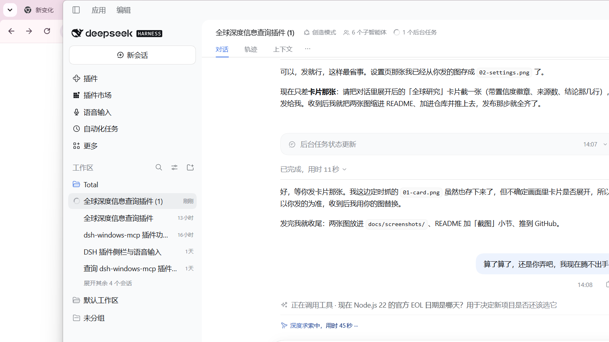

# dsh-global-research

[](https://github.com/qibufengliu-design/dsh-global-research/actions/workflows/ci.yml)
[](https://github.com/qibufengliu-design/dsh-global-research/actions/workflows/codeql.yml)
[](https://github.com/qibufengliu-design/dsh-global-research/releases)
[](LICENSE)
[](package.json)

给 DeepSeek Harness（DSH）增加一个 `research` 工具：把一个**开放问题**当成研究任务来做，而不是把关键词丢给搜索框。

拆题 → 多角度 query → 多引擎并行检索 → 去重排序 → 精读网页 → 抽证据卡 → 交叉验证 → 缺口回补 → 输出带 `[S1]` 行内引用的简报，每个关键论断都能回溯到原页。

```markdown
**一句话：后端项目选 pnpm，Monorepo 或需要严格依赖隔离时选它。**（[S1]）

## 结论
...（2–4 句前提与依据，每条带 [S#]）

## 方案对比
| 方案 | 冷装速度 | 磁盘占用 | 迁移成本 |
|---|---|---|---|
| pnpm | 最快（[S2]） | 硬链接，最省（[S2]） | 中（[S2]） |

## 行动清单
- 在 staging 用 pnpm 重装一次，记录耗时与 CI 缓存命中率

## 坑与风险
## 本题未解决
## 参考
```

## 为什么不用 `web_search`

| | `web_search` / `web_fetch` | `research` |
|---|---|---|
| 输入 | 关键词 | 完整问题（含背景与要做的决定） |
| 输出 | 链接列表 | 结论、依据、方案对比、坑、置信度、未解决 |
| 过程 | 一次检索 | 拆题 + 多轮检索 + 精读 + 交叉验证 + 回补 |
| 引用 | 无 | 每句关键论断带 `[S#]`，可回溯到原页 |
| 失败 | 报错 | 证据不足标 `low` + `gaps`，不编造；超预算返回 `partial` |

## 特性

- **答案先行**：第一行是一句话结论，随后才是依据；结论质量不够时明确写「证据不足」，不给虚假确定感（0.9.0）。
- **一手来源优先**：官方文档页 / 厂商价目页 / 标准原文优先于二手教程；standard/deep 档若全为二手来源，置信度强制降为 `low`。
- **垂直源直连**：GitHub、Stack Exchange、npm、PyPI、arXiv、OpenAlex、Hacker News，绕开通用引擎对「库 / 报错 / 论文」的召回短板。
- **证据可核查**：证据必须能在抓到的正文里匹配到才保留；悬空引用会被删除或标记「来源未列出」。
- **诚实标注**：冲突分「事实冲突 / 口径差异 / 来源自相矛盾」三类；过期页面不参与置信度；报告「另有 N 个页面被读取但未采用」。
- **过程可见**：简报末尾一行 `> 本次检索：6 个查询 · 9 个页面 · 14 条证据 · 73 秒（标准档）`，卡片解析成徽章。
- **零运行时依赖**：只用 Node.js 内置能力，`dependencies` 为空。

## 安装

本项目是 DSH bundle 插件，不发布到 npm，按「目录 + profile patch」安装：

```powershell
plugin_manager install_bundle target: <本仓库所在目录>   # 例：D:\plugins\dsh-global-research
```

装好后对当前 profile 的所有会话生效，新会话里模型能看到 `research` 工具。改动 host 侧代码后需要重载：

```text
plugin_manager set_plugin target: include:global-research enabled: false
plugin_manager set_plugin target: include:global-research enabled: true
```

改动 `client.js`（卡片 / 输入框胶囊）需要**完全重启桌面应用**——应用内的 `Ctrl+R` / `F5` 只切会话，不会重载页面。

迁移到另一台机器的完整步骤见 [docs/configuration.md#迁移到另一台机器](docs/configuration.md#迁移到另一台机器)。

## 快速开始

模型会自己决定何时调用；也可以在对话里直接说「用 research 调研……」。

```json
{
  "question": "2026 年给一个 Node.js 后端项目选包管理器：pnpm / yarn / bun 怎么选？",
  "depth": "auto",
  "focus": ["性能", "生态兼容", "迁移成本"],
  "outputLanguage": "zh"
}
```

返回对象含 `brief`（Markdown 简报）、`confidence`、`sources`、`gaps`、`partial`、`depthUsed`、`researchId`、`stats`；Web 端只渲染简报卡片。

## 参数

| 参数 | 必填 | 说明 |
|---|---|---|
| `question` | 是 | 完整问题（含背景与要做的决定），不是关键词；上限 2000 字 |
| `depth` | 否 | `auto`（默认，按问题里的对比/选型/约束词判断）/ `quick` / `standard` / `deep` |
| `focus` | 否 | 评估维度数组，参与 query 生成与结果排序 |
| `outputLanguage` | 否 | `zh` / `en` / `auto` |
| `context` | 否 | 追问上一轮结果时，把被指代的内容附进来（≤2000 字）。research 看不到对话历史；带 `context` 的调用不走缓存 |
| `researchId` | 否 | 上一轮返回的会话 id（简报末尾 `> 研究会话：rs_…`）。传回即续跑：复用已读页面与证据，只补新缺口，通常快 2–3 倍；30 分钟内有效 |
| `mode` | 否 | `explain` / `compare` / `track` / `evaluate`；不传则按问题推定。`compare` 强制对比表与适用条件 |
| `text` | 否 | 用户提供的资料（≤20000 字），作为最高优先级证据参与分析，不落盘。也可以先在插件设置页的「研究材料」粘贴区保存一份，下次调用自动带上；显式 `text` 优先 |
| `saveTo` | 否 | 把简报写成 Markdown 文件（含参考与统计行）；不传则不落盘 |

## 预算

| depth | queries | pages | LLM 轮 | 补搜轮 | 墙钟 |
|---|---|---|---|---|---|
| quick | 2 | 3 | 6 | 0 | 120s |
| standard | 6 | 12 | 14 | 1 | 240s |
| deep | 16 | 30 | 28 | 1 | 360s |

超出预算或时间返回 `partial: true`，并在「未解决」写明剩余问题，不编造。同一 agent 在进程内最多 5 次 `deep`，超出自动降为 `standard`。

## 配置

配置写在 profile 的 `cordis.patch.yml` 里，由 `lib/config.js` 校验：类型强转、越界夹取、未知键与非法枚举记 warning 后回退默认值——写错配置不会让工具崩掉。

```yaml
- id: global-research
  name: "@local/dsh-global-research"
  config:
    depthDefault: auto
    engines: { ctxWeb: true, ddgHtml: true, tavily: false }
    keys: { tavily: "tvly-替换成你自己的key" }
    cache: { enabled: true, ttlMinutes: 60, maxEntries: 16, persistPath: ".cache/research.json" }
```

常用键一览：

| key | 默认 | 说明 |
|---|---|---|
| `depthDefault` | `auto` | 未传 `depth` 时的档位，插件设置页可改，即时生效 |
| `material` | `''` | 设置页「研究材料」粘贴区保存的原文（≤20000 字）；每次 research 自动作为最高优先级证据，显式 `text` 优先 |
| `maxDeepPerSession` | `5` | 每个 agent 的 `deep` 次数上限 |
| `engines.*` | ctxWeb / ddgHtml 开 | 付费引擎 `tavily` / `brave` / `serper` / `exa` 关闭，开启后读 `keys` 或环境变量 |
| `pageFetcher` | `raw` | 正文抓取路径：`raw` / `web` / `auto` |
| `useJinaFallback` | `false` | 用 `r.jina.ai` 兜底 JS 重站点 |
| `timeoutMs` | `120000` | 工具级超时下限 |
| `verboseLog` / `debugStats` | `false` | 打印引擎日志 / 简报末尾附调试统计 |
| `cache.*` | 开启，60 分钟，16 条 | 结果缓存；`persistPath` 非空才落盘 |
| `domainTrust.trusted` / `.blocked` | `[]` | 额外可信域名 / 直接排除域名 |
| `verticals.*` | 全开 | GitHub / arXiv / StackExchange / npm / HN / PyPI 开关 |

全部配置键、付费引擎额度与 key 放法、缓存与时效性规则、设置页说明：见 [docs/configuration.md](docs/configuration.md)。

## 界面



Web 端不再是通用工具行，而是一张卡片：置信度徽章（高/中/低）、来源数、耗时、结论前三行、阶段耗时 chip，可展开完整简报。非 Web 端或卡片未注册时回退为纯 Markdown。

插件设置页可改默认深度、启停插件，并有一个「研究材料」粘贴区（把公司内部文档、合同条款、接口说明贴进去，≤20000 字，下次调用自动当最高优先级证据）。输入框右侧的胶囊可直接操作：点「深度」切换 `auto → quick → standard → deep`，点「研究」启停；保存过材料时多一枚「材料 N 字」胶囊（点击复制设置路径）。


## 可靠性

- 网页正文包在 `<untrusted>` 里，system prompt 禁止执行其中指令（降低提示注入风险）。
- 正文不足 400 字（JS 壳、导航残渣）、403、PDF/二进制一律判为「未获取」，绝不填充猜测内容。
- 生成后校验引用：不存在的 `[S#]` 删除，编号按首次出现重排；裸编号若不指向现存来源，替换为「〔来源未列出〕」。
- 零证据不再只是「没查到」（0.9.2）：报告前对每个「一条可用证据都没有」的对比选项做一次定向检索（最多 3 项 / 3 页），能补上就把页面放进参考，补不上才写「零证据」并注明「（已定向检索 1 次仍未获证）」。
- 单一来源的论断标「待验证」，来源冲突标「有争议」；过期/归档页面不参与置信度计算。
- 时效性问题（最新 / 当前 / 价格 / EOL / latest / price…）不缓存，命中缓存会在首行标注「本结果来自 N 分钟前的缓存」。
- 所有搜索源都失败时直接抛错，不返回空简报冒充结果。

机制细节（查询规划、官方直取、EUR-Lex Cellar 映射、sitemap 定向爬取、证据档位与排序）见 [docs/architecture.md](docs/architecture.md)。

## 边界与已知限制

这个工具擅长「有公开资料、且正文抓得到」的研究题。做不到的部分集中写在一页里：[LIMITATIONS.md](LIMITATIONS.md)——JS 渲染页与登录墙（走 Jina 兜底，或把正文贴进 `text`）、没有站点地图的官方站、币种与计费口径不归一、中文与非英语来源召回弱、`confidence` 是多源一致性而非事实正确率、预算到头返回 `partial` 不等于「查完了」。

测试规模不在文档里写死（加一个测试就会过期，`scripts/check-release.mjs` 也会拦）：跑 `node scripts/test-all.mjs`，总数以脚本输出为准。

## 常见问题

**为什么查不到某个官网的价格 / 参数？**
官网多是 JS 渲染或登录墙。把 URL 直接贴进问题里，工具会优先直取该页（URL 直取），不依赖搜索引擎召回。

**为什么 confidence 经常是 low？**
`low` 表示关键结论缺少一手或独立来源，简报会把缺口写进「未解决」。这不是失败，而是诚实标注；按「未解决」补一轮或给出官方 URL，通常能升到 `medium` / `high`。0.9.1 起，同一厂商文档的**不同文档段**分别计入广度（如 8 条 Spring / LangChain4j 官方文档不会再被判 `low`），但跨源确认仍按站点计——同一厂商的文档不会被当成互相独立确认。

**要花钱吗？**
本体免费。检索默认走 `ctx-web` 与 DuckDuckGo（后者在很多网络下会被 challenge 拦截），建议配一个免费的 Tavily key（每月 1000 次）。

**会编造引用吗？**
不会。证据必须能在抓到的正文里匹配到才保留；引用编号会被校验，悬空的 `[S#]` 会被删除。

**数据会上传吗？**
只把问题与抓到的正文片段交给本机配置的模型；缓存与追问会话按配置处理（默认只在内存，60 分钟过期）。

## 开发

```powershell
node scripts/test-all.mjs       # 逐文件跑全部测试（沙箱里 node --test test/ 会 spawn EPERM）
node --check index.js client.js
node scripts/check-docs.mjs     # 仓库整洁性：必需文件、相对链接、CHANGELOG、零依赖、Issue 表单、README 参数表与工具参数一致、JSON 示例可解析、文档里的脚本命令真实存在、没有密钥或本机绝对路径、docs 都能从 README 链到、workflow 结构完整
node scripts/check-release.mjs  # 发布一致性：版本号、CHANGELOG 小节（非空、不重复、从新到旧）、预算表与代码一致
```

- 目录结构、调试技巧、`retrieval-check` 与真实网络 e2e：见 [docs/development.md](docs/development.md)。
- 提交规范、PR 检查表、版本与发布流程：见 [CONTRIBUTING.md](CONTRIBUTING.md) 与 [docs/release.md](docs/release.md)。
- 变更历史：见 [CHANGELOG.md](CHANGELOG.md)。

## 文档

| 文档 | 内容 |
|---|---|
| [docs/architecture.md](docs/architecture.md) | 管线十步、模块职责、sourcePlan 通道、sitemap 定向爬取、证据分级与排序 |
| [docs/configuration.md](docs/configuration.md) | 全部配置键、付费引擎、垂直源、缓存、设置页、迁移到另一台机器 |
| [docs/development.md](docs/development.md) | 本地环境、测试、真实网络回归、调试与排错 |
| [docs/release.md](docs/release.md) | 版本号规则、发布清单、推送环境要求 |
| [LIMITATIONS.md](LIMITATIONS.md) | 已知限制：做不到什么、为什么、以及怎么绕 |
| [CHANGELOG.md](CHANGELOG.md) | 每个版本改了什么 |
| [CONTRIBUTING.md](CONTRIBUTING.md) | 开发环境、提交规范、PR 检查表 |
| [SECURITY.md](SECURITY.md) | 支持版本、漏洞报告方式与响应时间 |
| [CODE_OF_CONDUCT.md](CODE_OF_CONDUCT.md) | 社区行为准则 |

## 许可证

[MIT](LICENSE) © 2026 liuqibufeng